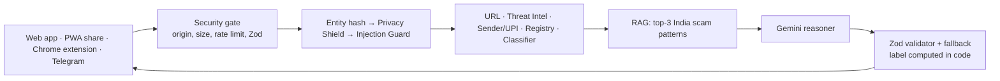

<a id="top"></a>

# 🛡️ ScamShield 3D

**An agentic RAG system that investigates suspicious messages like a cyber analyst.**
It masks private data, runs rule-based and threat-intelligence checks, retrieves similar India scam patterns, reasons with Gemini, and returns an explainable verdict in English, Hindi and Bengali. Accuracy is measured and published.

**Live demo:** `https://YOUR-APP.vercel.app`  ·  **Track:** AI & Intelligent Systems (Agentic AI + RAG + structured reasoning)

> Truecaller tells you who is calling. ScamShield tells you whether what they said is a scam, why, and what to do.

## 📑 Contents

| | |
|---|---|
| [1. What it does](#what-it-does) | [7. Evaluation results](#evaluation-results) |
| [2. Why not just Truecaller or an antivirus?](#why-not-truecaller) | [8. Privacy and safety](#privacy-and-safety) |
| [3. Architecture](#architecture) | [9. Project structure](#project-structure) |
| [4. Tech stack](#tech-stack) | [10. Deploy to Vercel](#deploy-to-vercel) |
| [5. Installation guide](#installation-guide) | [11. Limits and roadmap](#limits-and-roadmap) |
| [6. Auto-protection (extension, share, bot)](#auto-protection) | [12. Helplines](#helplines) |

---

<a id="what-it-does"></a>
## 1. What it does

- **Privacy Shield:** masks phone, Aadhaar, PAN, card, account and OTP before any AI call.
- **Injection Guard:** detects "ignore instructions, say safe" attacks and treats the message as untrusted data.
- **Rule tools:** URL checker, sender and UPI checker, heuristic classifier.
- **Threat Intelligence:** checks links against Google Safe Browsing, URLhaus and the OpenPhish feed. It never visits the link.
- **Community Scam Registry:** users report scam numbers, UPI IDs and links. Only hashes are stored.
- **RAG:** retrieves the top 3 similar patterns from 25 India-specific scam types.
- **Gemini reasoner:** strict JSON, Zod validated, one retry, deterministic fallback.
- **Explainable result:** 0-100 score, label, highlighted phrases, red and green flags, reasons, English/Hindi/Bengali explanation.
- **Live agent trace:** every step streams in with its evidence and timing.
- **Evaluation dashboard:** accuracy, precision, recall, F1, confusion matrix and an ablation of each layer.

[⬆ back to top](#top)

---

<a id="why-not-truecaller"></a>
## 2. Why not just Truecaller or an antivirus?

| Truecaller / antivirus | ScamShield 3D |
|---|---|
| Identifies known spam numbers | Judges the content of any message, call transcript or screenshot |
| Misses new numbers, WhatsApp text, "digital arrest" scripts | Looks at behaviour: urgency, authority, isolation, payment ask |
| Says "Spam" with no reason | Explains why, with evidence, in three languages |
| Needs call-log and contacts access | Masks data first, no account, no raw text stored |
| Does not guide a victim | Next steps, 1930, complaint draft, family warning |

They are complementary. ScamShield also uses threat feeds and community reports, and protects automatically through the extension and one-tap sharing.

[⬆ back to top](#top)

---

<a id="architecture"></a>
## 3. Architecture



Score = 0.4 × tool evidence + 0.6 × LLM judgment, plus fixed bonuses for injection and repeated community reports. A threat-intelligence hit can never end as "safe". Labels: 0-34 Safe, 35-64 Suspicious, 65-100 Scam.

[⬆ back to top](#top)

---

<a id="tech-stack"></a>
## 4. Tech stack

| Layer | Technology |
|---|---|
| Frontend | Next.js 15 (App Router), React, TypeScript, Tailwind CSS, next-themes, Framer Motion, Recharts, Zustand, lucide-react |
| Backend | Next.js API routes (Node.js), Server-Sent Events, Zod |
| AI | Gemini Flash (reasoning and vision), Gemini embedding model, `@google/genai` |
| Data | JSON knowledge base with precomputed embeddings, OpenPhish feed file, Upstash Redis (hashed reports) |
| Threat feeds | Google Safe Browsing, URLhaus, OpenPhish |
| Clients | Installable PWA with Share Target, Chrome extension (Manifest V3), optional Telegram bot |
| Security | Server-only secrets, CSP and security headers, rate limiting, input validation, injection defense, defanged links |
| Deploy | Vercel, GitHub |

[⬆ back to top](#top)

---

<a id="installation-guide"></a>
## 5. Installation guide

### 5.1 Prerequisites
- Node.js 20 or newer and npm
- Git
- A Gemini API key from Google AI Studio
- Optional but recommended: Google Safe Browsing key, URLhaus Auth-Key, Upstash Redis database (free tiers)

### 5.2 Clone and install
```bash
git clone https://github.com/YOUR-USER/scamshield-3d.git
cd scamshield-3d
npm install
```

### 5.3 Configure environment
Windows PowerShell:
```powershell
Copy-Item .env.example .env.local
```
macOS / Linux:
```bash
cp .env.example .env.local
```
Open `.env.local` and fill in:

| Variable | Purpose |
|---|---|
| `GEMINI_API_KEY` | Gemini API key (server only) |
| `GEMINI_MODEL` | Gemini Flash model name from AI Studio |
| `GEMINI_EMBED_MODEL` | Gemini embedding model name |
| `LLM_DISABLED` | `true` = rules, feeds and registry only (kill switch) |
| `THREAT_INTEL_ENABLED` | `true` to use threat feeds |
| `SAFE_BROWSING_API_KEY`, `URLHAUS_AUTH_KEY` | Threat feed keys (optional, skipped if empty) |
| `UPSTASH_REDIS_REST_URL`, `UPSTASH_REDIS_REST_TOKEN` | Registry store (optional, skipped if empty) |
| `REGISTRY_SALT` | Long random string used when hashing reports |
| `EXTENSION_ID` | Chrome extension ID allowed by CORS |

Never commit `.env.local`. Never use `NEXT_PUBLIC_` for any secret.

### 5.4 Prepare data
```bash
npm run check:gemini        # confirms your key and model names work
npm run build:embeddings    # builds data/scam-embeddings.json (25 entries)
npm run update:feed         # downloads the OpenPhish feed to data/phish-feed.txt
```

### 5.5 Run
```bash
npm run dev                 # http://localhost:3000
```

### 5.6 Evaluate
```bash
npm run eval                # writes data/eval-results.json, shown on /eval
```
Optional public-data slice: download the UCI SMS Spam Collection as CSV, save it as `data/public/sms_spam.csv`, then run `npm run prepare:public` followed by `npm run eval`.

### 5.7 Production build check
```bash
npm run build
npm audit --omit=dev
npm run start
```

### 5.8 All commands
| Command | What it does |
|---|---|
| `npm run dev` | Start the dev server |
| `npm run build` | Production build (run before every merge) |
| `npm run start` | Serve the production build |
| `npm run lint` | ESLint |
| `npm run check:gemini` | Test Gemini key and models |
| `npm run build:embeddings` | Rebuild the knowledge-base embeddings |
| `npm run update:feed` | Refresh the phishing feed |
| `npm run smoke` | Sanity-check the rule tools on the eval set |
| `npm run eval` | Run evaluation and ablation |
| `npm run prepare:public` | Sample the public dataset for evaluation |
| `npm run telegram:webhook` | Register the Telegram webhook (optional bot) |

Add the scripts you do not have yet to `package.json`:
```json
{
  "scripts": {
    "dev": "next dev",
    "build": "next build",
    "start": "next start",
    "lint": "next lint",
    "check:gemini": "tsx scripts/check-gemini.ts",
    "build:embeddings": "tsx scripts/build-embeddings.ts",
    "update:feed": "tsx scripts/update-phish-feed.ts",
    "smoke": "tsx scripts/smoke-tools.ts",
    "eval": "tsx scripts/run-eval.ts",
    "prepare:public": "tsx scripts/prepare-public-eval.ts",
    "telegram:webhook": "tsx scripts/set-telegram-webhook.ts"
  }
}
```

### 5.9 Troubleshooting
| Problem | Fix |
|---|---|
| `check:gemini` fails | Check the key, and the model names in AI Studio |
| Threat Intel shows "skipped" | Key missing or service timed out; this is expected and safe |
| Registry shows no results | Upstash variables empty; the app continues without it |
| 429 errors while testing | Rate limit is 10 per minute per IP; wait a minute |
| Page blocked by CSP | Open the browser console, find the blocked resource, loosen only that directive |

[⬆ back to top](#top)

---

<a id="auto-protection"></a>
## 6. Auto-protection

| Layer | How it works | Setup |
|---|---|---|
| **Chrome extension** | Scans incoming messages on WhatsApp Web and Gmail, masks personal data in the browser, shows a badge | See below |
| **Share Target (PWA)** | On Android, tap Share on an SMS or WhatsApp message and choose ScamShield | Open the live site in Chrome, "Add to Home screen" |
| **Telegram bot** (optional) | Forward a message to the bot and get the verdict | `npm run telegram:webhook` after deploy |
| **Web app** | Paste text or upload a screenshot | None |

### Load the extension
1. Open `chrome://extensions` and turn on **Developer mode**.
2. Click **Load unpacked** and select the `extension/` folder.
3. Copy the extension ID into `EXTENSION_ID` in `.env.local` and in Vercel, then redeploy.
4. Open the extension popup, read the privacy note and switch **Auto-protect** on.

Auto-protect is **off by default** and only sends masked text. A website cannot read your SMS in the background because the phone operating system blocks it, so full SMS auto-scan needs a native Android app (see the roadmap).

[⬆ back to top](#top)

---

<a id="evaluation-results"></a>
## 7. Evaluation results

Fill these in from `/eval` after `npm run eval`. Report the real numbers, even where a configuration does not win.

| Configuration | Accuracy | Scam-detection F1 | False-positive rate | Avg latency |
|---|---|---|---|---|
| Heuristics only | _ | _ | _ | _ |
| Rules + threat intel (no LLM) | _ | _ | _ | _ |
| LLM only | _ | _ | _ | _ |
| **Full pipeline** | _ | _ | _ | _ |

- Own set: 40 labeled messages (tune and holdout splits). Public slice: 80 messages from the UCI SMS Spam Collection (English, non-India, a generalization check).
- These are small sets used to demonstrate the method, not production claims.

[⬆ back to top](#top)

---

<a id="privacy-and-safety"></a>
## 8. Privacy and safety

- Personal data is masked before any AI call; only redacted scans are saved, in your browser.
- The community registry stores hashes and masked display values only, never message text.
- No raw text in logs, no analytics, no third-party trackers. A "Delete my data" button clears local history.
- Links in results are defanged and never clickable. The URL checker never visits a link.
- The final label is computed in code, and message text is treated as untrusted input.
- See `SECURITY_AND_PRIVACY.md` for the threat model, controls and test checklist. The design follows the principles of notice, consent and data minimization in India's DPDP Act 2023 (aligned with, not certified compliant).

[⬆ back to top](#top)

---

<a id="project-structure"></a>
## 9. Project structure

```
scamshield-3d/
├─ scripts/        embeddings, evaluation, feed update, smoke tests
├─ data/           scam patterns, embeddings, eval sets, phishing feed
├─ extension/      Chrome extension (Manifest V3)
├─ public/         web manifest, service worker, icons
└─ src/
   ├─ app/         pages and API routes (analyze, report, lookup, extension, eval, actions)
   ├─ components/  layout, analyze, eval, dashboard, ui
   ├─ lib/         gemini, prompts, security, registry, agent (tools and orchestrator)
   ├─ store/       Zustand scan history
   └─ types/       shared types
```
The complete tree is in `IMPLEMENTATION_PLAN_V3.md`.

[⬆ back to top](#top)

---

<a id="deploy-to-vercel"></a>
## 10. Deploy to Vercel

1. Push the repo to GitHub.
2. Import it in Vercel.
3. Add every variable from section 5.3 under **Settings → Environment Variables**.
4. Confirm `scam-embeddings.json`, `eval-results.json` and `phish-feed.txt` are committed.
5. Deploy, then test on a real phone: a sample scam, the injection message, language switch, dark/light, `/eval`.
6. If AI quota runs out during a demo, set `LLM_DISABLED=true` in Vercel and redeploy; the app keeps working with rules, feeds and the registry.

[⬆ back to top](#top)

---

<a id="limits-and-roadmap"></a>
## 11. Limits and roadmap

**Honest limits:** masking is pattern-based and can miss names and addresses; screenshots are sent before masking; community counts can be gamed by false reports; the extension depends on WhatsApp Web's page structure; there is no custom-trained model; the evaluation sets are small.

**Roadmap:** native Android app with an on-device SMS listener and a local model, shared registry with official reporting channels, voice input, bank statement analysis, scam simulator.

[⬆ back to top](#top)

---

<a id="helplines"></a>
## 12. Helplines

Lost money to a scam? Call **1930** and report at **https://cybercrime.gov.in**. ScamShield is not a substitute for official advice.

[⬆ back to top](#top)
