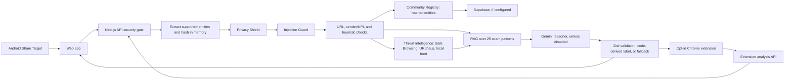

# ScamShield 3D

ScamShield 3D is a prototype that helps people inspect suspicious messages and
call transcripts. It combines privacy masking, deterministic checks, threat
intelligence, a small India-focused scam-pattern knowledge base, and an
optional Gemini reasoner. Results include evidence and a pipeline trace; they
are not a guarantee that a message is safe or a substitute for official advice.

## The problem and positioning

Scam messages often rely on urgency, impersonation, secrecy, or requests for
money and credentials. A contact-identification or antivirus product may
address a different part of that problem. ScamShield focuses on the content of
a message and explains which signals contributed to its assessment.

| Typical focus | ScamShield 3D prototype focus |
|---|---|
| Identify a caller, sender, file, or known threat | Inspect pasted message text or a call transcript |
| Detect known spam or malicious artifacts | Combine message patterns, URL checks, optional threat feeds, and scam-pattern retrieval |
| Present a warning or block | Show a score, evidence, flags, and next-step guidance |
| Product-specific data and permissions | Web scans are opt-in; the Chrome extension is off until consent |

These are different approaches and can be complementary. ScamShield may miss
scams or flag legitimate messages; verify unexpected requests through an
official channel.

## What is included

- Privacy Shield masking, injection detection, URL and sender/UPI checks, and
  rule-based classification.
- Optional Google Safe Browsing and URLhaus lookups, plus local matching against
  the OpenPhish community feed. The app checks URLs as data; it does not visit
  the submitted links.
- Retrieval from 25 project-maintained scam patterns.
- Optional Gemini reasoning with schema validation and a deterministic fallback.
- An explainable verdict and streaming trace, with English, Hindi, and Bengali
  explanations.
- A web app, Android Share Target for sending content into the app, and an
  opt-in Chrome extension prototype for visible incoming WhatsApp Web and Gmail
  messages.
- A community report registry backed by Supabase when configured. Reports are
  signals, not verified claims.

Screenshot analysis and automatic Android SMS reading are not implemented.

## Architecture



The order in the agent pipeline is entity hashing, privacy masking, injection
guard, URL checker, threat intelligence, sender/UPI checker, heuristic
classifier, community registry, RAG, Gemini reasoner, and validation/fallback.
The Gemini reasoner receives redacted message text. The final label is
calculated in code from the score: 0-34 safe, 35-64 suspicious, and 65-100
scam. A matching threat-intelligence result prevents a safe label.

## Data sources and terms

Terms can change. The notes below are a short guide, not legal advice; consult
the linked terms before redistribution, commercial use, or a public
customer-facing deployment.

| Source | How this project uses it | License or terms to observe |
|---|---|---|
| Project scam patterns and evaluation examples | Local JSON files used for retrieval and internal evaluation | These are repository-maintained demo materials. The repository does not assign a separate third-party data license to them; do not treat them as a licensed external corpus. |
| Google Safe Browsing Lookup API v4 | Optional server-side URL lookup when enabled and an API key is configured | [Google Safe Browsing API Terms](https://developers.google.com/safe-browsing/terms) prohibit commercial use absent a separate agreement. They require appropriate attribution and a notice that reliability and accuracy are not guaranteed when the app presents protection warnings. Submitted URLs and associated data may be used/shared as described in the terms. |
| URLhaus Community API | Optional server-side URL lookup when enabled and an Auth-Key is configured | The [URLhaus API documentation](https://urlhaus.abuse.ch/api/) makes the community API available under [abuse.ch fair-use principles](https://abuse.ch/terms-of-use/#principles). Commercial or for-profit use may require its enhanced commercial API. |
| OpenPhish Community Feed | A local feed file is matched against URL hosts and full URLs; the app does not fetch submitted links | The [OpenPhish feed page](https://openphish.com/phishing_feeds.html) links to its [Terms of Use](https://openphish.com/terms.html). The terms restrict commercial/business use and redistribution. Obtain written permission before using it for organizational operations, customer protection, or redistribution. Review the terms before publishing or deploying a copy of the feed. |
| UCI SMS Spam Collection | Optional, reproducibly sampled public evaluation slice; not used by the live pipeline | The [UCI dataset page](https://archive.ics.uci.edu/dataset/228/sms+spam+collection) lists **CC BY 4.0**. Attribute Almeida and Hidalgo, *SMS Spam Collection*, UCI Machine Learning Repository, DOI [10.24432/C5CC84](https://doi.org/10.24432/C5CC84). |
| Google Gemini API | Optional analysis of redacted text and embeddings | Read the current [Gemini API Terms](https://ai.google.dev/gemini-api/terms). Data handling differs by service/account type: the terms state that unpaid-service prompts and responses may be used to improve services and may be human-reviewed. Do not submit sensitive or confidential content, even after masking. |

When threat-intelligence lookups are enabled and their keys are configured, the
URLs extracted from a message are sent to the configured remote lookup
providers. The complete message is not sent to those providers. OpenPhish
matching uses the local feed. See the [privacy page](./src/app/privacy/page.tsx)
and [security and privacy notes](./SECURITY_AND_PRIVACY.md) for the application
data flow.

## Run locally

### Requirements

- Node.js 20 or newer and npm.
- A Gemini API key and configured model names for Gemini-backed analysis.
- Optional: Google Safe Browsing and URLhaus credentials for their remote
  lookups.
- Optional: a Supabase project for the community registry.

### Install and configure

```powershell
npm install
Copy-Item .env.example .env.local
```

On macOS or Linux, use `cp .env.example .env.local`. Edit `.env.local` and set
the values you need:

| Variable | Purpose |
|---|---|
| `GEMINI_API_KEY` | Server-only Gemini API key |
| `GEMINI_MODEL` | Server-side reasoner model name |
| `GEMINI_EMBED_MODEL` | Server-side embedding model name |
| `LLM_DISABLED` | Set to `true` to skip Gemini and embedding calls |
| `THREAT_INTEL_ENABLED` | Enables threat-intelligence checks when `true` |
| `SAFE_BROWSING_API_KEY` | Optional Google Safe Browsing key |
| `URLHAUS_AUTH_KEY` | Optional URLhaus Auth-Key |
| `SUPABASE_URL` | Optional Supabase project URL |
| `SUPABASE_SERVICE_ROLE_KEY` | Optional server-only Supabase credential |
| `REGISTRY_HASH_SALT` | Random server secret of at least 32 characters for registry hashes |
| `CHROME_EXTENSION_ID` | Extension ID allowed by the extension API |

Never use a `NEXT_PUBLIC_` prefix for secrets and never commit `.env.local`.
Configure only services whose terms and privacy disclosures you can meet.

If using Supabase, run [`supabase/schema.sql`](./supabase/schema.sql) in the
project's SQL editor, then configure the three registry variables. The registry
is optional; the pipeline continues if it is unavailable.

### Start the app

```bash
npm run dev
```

Open [http://localhost:3000](http://localhost:3000). Other available commands:

| Command | Purpose |
|---|---|
| `npm run lint` | Run ESLint |
| `npx tsc --noEmit` | Type-check the project |
| `npm run build` | Create a production build |
| `npm run start` | Serve a production build |
| `npm run check:gemini` | Check configured Gemini credentials and models |
| `npm run build:embeddings` | Build embeddings for the scam-pattern knowledge base |
| `npm run update:feed` | Update the local OpenPhish feed; observe OpenPhish terms |
| `npm run try:pipeline` | Run the sample pipeline check |
| `npm run eval` | Evaluate the labeled project dataset and write `data/eval-results.json` |
| `npm run prepare:public-eval` | Create an 80-item public slice from the supplied UCI CSV |

### Optional public evaluation

Obtain the UCI SMS Spam Collection from its [official dataset page](https://archive.ics.uci.edu/dataset/228/sms+spam+collection)
and place the CSV at `data/public/sms_spam.csv`. Then run:

```bash
npm run prepare:public-eval
npm run eval
```

The preparation script uses a fixed seed to sample 40 spam and 40 ham messages.
It writes `data/eval-public.json`; the evaluation script writes separate
public results. The CSV and generated public dataset are not included here.

### Chrome extension

Follow [`extension/README.md`](./extension/README.md) to load the unpacked
Manifest V3 extension. Before using it, set the API origin in
`extension/constants.js` and `extension/manifest.json`, configure
`CHROME_EXTENSION_ID` in the server environment, and reload/redeploy. The
extension is opt-in and off until the user accepts its consent screen.

The [PWA manifest](./public/manifest.webmanifest) exposes an Android Share
Target. Install the deployed web app from a supported browser and share text to
ScamShield; this does not give the app background access to SMS.

## Privacy and security

| Location | Data handling |
|---|---|
| Browser web app | Stores redacted scan text and verdicts in local storage on this device. The consent preference is also stored locally. Use **Delete my data** to clear scan history. |
| ScamShield server | Processes the incoming request in memory and does not persist message text. Application logs contain request metadata, not raw message text or request headers. |
| Gemini | Receives redacted text for reasoning or embedding when the relevant AI calls are enabled. Pattern-based masking can miss names, addresses, or other sensitive information. |
| Threat-intelligence providers | May receive extracted URLs for lookup when the corresponding remote integrations are enabled and configured. |
| Supabase registry | Stores salted hashes, masked/defanged display values, categories, counts, and timestamps—not raw message text or entity values. Reports can be false and counts are not verified unique people. |
| Chrome extension | When enabled, reads visible incoming message text on WhatsApp Web or Gmail, applies client-side masking, and sends masked text to the configured ScamShield server. It stores a random installation token, counters, and a bounded result cache keyed by a hash of masked text. |

Screenshots are not supported in this version. Rate limiting is best-effort
across server instances. The extension depends on third-party site DOM
structures and may stop working if those sites change.

For the threat model, security controls, privacy limits, and test checklist,
see [SECURITY_AND_PRIVACY.md](./SECURITY_AND_PRIVACY.md). For the user-facing
data explanation, see the [Privacy page](./src/app/privacy/page.tsx).

## Evaluation results

The current internal evaluation was generated on **2026-11-14** using 46
project-labeled examples: 27 tune items and 19 holdout items (13 safe, 6
suspicious, and 27 scam). Scam-detection metrics count both suspicious and scam
as positive. Latencies below are averages from that run.

| Configuration | Scored / 46 | Errors | Accuracy | Scam precision | Scam recall | Scam F1 | Safe false-positive rate | Avg latency |
|---|---:|---:|---:|---:|---:|---:|---:|---:|
| Rules only | 46 | 0 | 32.6% | 100.0% | 27.3% | 42.9% | 0.0% | 2 ms |
| Rules + threat intelligence (no LLM) | 46 | 0 | 32.6% | 100.0% | 36.4% | 53.3% | 0.0% | 1 ms |
| LLM only | 0 | 46 | Not available | Not available | Not available | Not available | Not available | 259 ms |
| Base full pipeline (without threat intelligence/registry) | 0 | 46 | Not available | Not available | Not available | Not available | Not available | 424 ms |
| Full + threat intelligence + registry | 0 | 46 | Not available | Not available | Not available | Not available | Not available | 428 ms |

The three Gemini-dependent configurations produced fallback/error results for
all 46 items; the evaluator excluded those items from metrics. Their accuracy
is **unavailable**, not zero. The public UCI CSV was not present when this
report was generated, so there are no public-dataset metrics yet. These small
results are indicative of the current demo only, not production performance.

The detailed results and per-item outcomes are in
[`data/eval-results.json`](./data/eval-results.json); `/eval` displays the
internal results and the public slice when it has been prepared.

## Limits and roadmap

### Current limits

- Pattern-based masking can miss names, addresses, and other personal data.
- Threat feeds are incomplete and may be unavailable; a missing match does not
  mean a URL is safe.
- Community reports can be false, duplicated across users, or otherwise
  misleading.
- A safe verdict is not a guarantee. Do not use the app as the only basis for a
  financial or safety decision.
- The internal evaluation is a small, manually labeled demo set. Gemini-backed
  metrics are unavailable in the current generated results.
- The public UCI slice, when prepared, is English-language and non-India; it
  does not measure performance on Indian-language messages.
- No native SMS listener, on-device model, bank integration, or telecom
  partnership is included.

### Roadmap

- Explore a native Android SMS listener with explicit user consent.
- Explore an on-device model to reduce data sent to external services.
- Seek bank and telecom partnerships for verified reporting and guidance.
- Explore a shared registry and official reporting integrations with **1930**
  and [cybercrime.gov.in](https://cybercrime.gov.in).

## Emergency help

If you lost money to a scam in India, call **1930** and report at
[cybercrime.gov.in](https://cybercrime.gov.in). ScamShield is not a substitute
for official advice.
